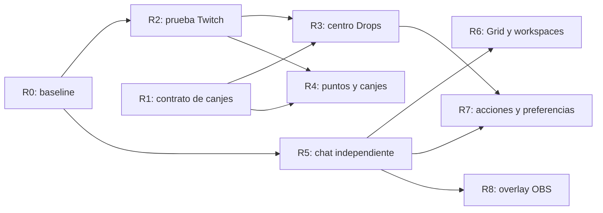

# Plan de implementación: recompensas y experiencia de escritorio

Actualizado: 2026-11-04. Estado: plan solicitado; implementación pendiente.

Base: [revisión de StreamNook](reviews/STREAMNOOK_REVIEW_2026-11-04.md), fuente BlinkStream c8ca7ca y candidata 1.5.4/17. Este documento concreta la iniciativa; [EXECUTION_PLAN](EXECUTION_PLAN.md) conserva el orden general del producto y [PROJECT_STATE](PROJECT_STATE.md) registra lo realmente entregado.

## Objetivo

Mejorar Drops, puntos y canjes, y después la organización del escritorio: chat independiente, Grid con foco de audio, paleta de acciones, preferencias del chat y overlay OBS. Reutilizar la base BlinkStream, conservar su identidad visual y medir que las mejoras no degraden reproducción ni seguridad.

Responsables: Codex implementa, revisa y ejecuta pruebas; el usuario acepta las candidatas en su sesión real. No hay fechas cerradas ni versiones PATCH reservadas para funciones aún no validadas.

## Orden y alcance

| ID | Entrega | Dependencia | Tamaño relativo | Cierre |
|---|---|---|---|---|
| R0 | Consolidar 1.5.4 y registrar baseline | Candidata17 | Pequeño, validación pendiente | Reproducción, Mod View y corrección de barra aceptadas; gates de entrega |
| R1 | Corregir contrato del canje y separar roles | Inspección de rutas existentes | Pequeño | Sin POST Helix incorrecto; alternativa oficial útil; estados y errores coherentes |
| R2 | Prueba de viabilidad de Drops y puntos | R0; cuenta/campaña elegibles | Medio, incertidumbre alta | Evidencia de crédito remoto y matriz de capacidades, o resultado negativo documentado |
| R3 | Centro de Drops y campañas | R1; fuentes de inventario verificadas en R2 | Medio | Descubrimiento disponible, progreso y objetos obtenidos coherentes |
| R4 | Saldo, cofres y canjes del espectador | R1 y viabilidad específica R2 | Grande, condicionado | Operaciones confirmadas y sin doble gasto; fallback oficial donde corresponda |
| R5 | Chat Ligero independiente | R0; lifecycle compartido inspeccionado | Medio/grande | Pestañas y después divisiones sin conexiones duplicadas ni pérdidas de FPS |
| R6 | Grid con foco de audio y workspaces | Base VOD/bookmarks de 1.6 y R5 | Grande | Calidad por celda, restauración y ciclo de vida verificados |
| R7 | Paleta, preferencias de chat y avisos | R3/R5; acciones existentes | Medio, varias entregas | Navegación rápida y personalización privada accesible |
| R8 | Overlay para OBS | R5; evaluación de transporte y privacidad | Grande, posterior | Fuente OBS opt-in validada, revocable y sin exponer credenciales |

Tamaños relativos expresan complejidad, no plazos. R2 y R4 tienen decisiones de continuar o limitar alcance; no se consideran comprometidas sus capacidades privadas. R3 puede avanzar con inventario verificado aunque falle la acreditación nativa. Los fallos de un experimento no bloquean chat, organización ni la release estable.

## R0 — Cerrar la base de reproducción

- Confirmar candidata17: barra inferior ausente y capacidad real en Ajustes → Grabación.
- Registrar una línea base en el mismo equipo: 1080p H.264, 1440p HEVC cuando exista canal elegible, Chat Ligero, ventana oficial separada y Mod View combinado.
- Medir arranque, latencia respecto al borde HLS, métrica por fecha del vídeo por separado, FPS, fotogramas perdidos, pausas, CPU/RAM/GPU. Registrar runtime, canal, calidad y duración para repetir comparaciones.
- Realizar sesiones de al menos 20 minutos y cambios de canal/pausa/DVR/salida. Si un escenario falla, corregirlo antes de atribuirle nuevas funciones.
- Generar artefactos finales y MSIX desde la fuente aceptada; no reutilizar el MSIX antiguo de candidata3. Firma/CI/updater y comprobación por plataforma según el gate habitual.

Aceptación: sin congelaciones sostenidas ni el salto inicial conocido de latencia en los casos reproducibles. El baseline medido determina el presupuesto de regresión; no se promete una latencia universal. Esta fase no instala automáticamente nada en el PC.

## R1 — Contratos correctos antes de ampliar canjes

Áreas: `src/utils/twitch.js`, `src/hooks/useChannelPoints.js`, `src/hooks/useManageRewards.js`, componentes `channelpoints/`, `modview/RewardsQueuePanel.jsx` y pruebas existentes.

1. Separar explícitamente tres capacidades: reclamar un cofre; gastar puntos como espectador; gestionar un canje como creador/moderador.
2. Retirar la llamada POST Helix incorrecta del flujo del espectador. Actualizar textos: no atribuir este fallo a la restricción de gestión por aplicación creadora.
3. Conservar la consulta de recompensas gestionables y autorización del creador para PATCH de gestión. No añadir scopes como supuesto arreglo de una operación que la API no ofrece.
4. Cuando no exista un transporte nativo validado, abrir la superficie oficial adecuada, siguiendo el patrón de ventana oficial de Windows; no mostrar una confirmación local de canje.
5. Representar capacidades como disponible, requiere sesión, requiere creador, solo oficial, temporalmente no disponible. Un error no se convierte en lista vacía o saldo cero.

Aceptación: pruebas de espectador/moderador/creador, recompensa propia/externa, sesión caducada y cambio de canal. Ningún intento usa la ruta incorrecta; ningún botón promete aprobar/rechazar recompensas externas por Helix. Ocho idiomas y alternativa oficial comprobada.

Esta corrección puede incorporarse al cierre de 1.5.4 si permanece acotada y pasa sus regresiones; las funciones amplias se entregan después.

## R2 — Demostrar crédito y capacidades de Twitch

Áreas: `src-tauri/src/drops_watch.rs`, sincronización Drops de `lib.rs`, `embedded_drops.rs`, `src/utils/drops.js`, `useTwitchDrops.js` y señal de reproducción existente.

1. Trazar la identidad de OAuth propio, sesión web oficial y reproducción sin imprimir tokens/cookies. Verificar cuenta y Client-ID; no intercambiar credenciales de clientes diferentes.
2. Elegir una campaña activa, cuenta vinculada y canal elegible con requisito conocido. Guardar inventario inicial, progreso remoto intermedio/final y resultado del reclamo oficial.
3. Comparar Twitch oficial y BlinkStream en ventanas de prueba separadas de al menos 15 minutos, sin reproducción concurrente que contamine la atribución. Registrar estado de red y reloj; no modificar el reloj del usuario.
4. Comprobar pausa, buffering, minimización, cambio/cierre de canal, logout y restauración. Medir el avance de vídeo real; no iniciar crédito optimistamente al seleccionar canal.
5. Evaluar por separado lectura de saldo, disponibilidad de cofres, reclamación y canje. No inferir una capacidad a partir del éxito de otra.
6. Producir una matriz por capacidad con fuente, identidad, permisos, resultado real, caducidad y fallback.

Decisión de salida:

- Si progresa el inventario: conservar el transporte mínimo que se haya validado y documentar sus límites.
- Si solo se acepta HTTP sin progreso: mantener la acreditación como no confirmada y la alternativa oficial.
- Si se exige cliente ajeno, evasión de integridad o tráfico que simula consumo: no trasladar esa técnica; conservar UI y fuentes verificadas.

No añadir un player oculto, peticiones HEAD para aparentar consumo, tokens al frontend, bypass DNS o extracción de integridad. Las hipótesis de StreamNook orientan las pruebas, no se convierten en implementación por defecto.

Aceptación: progreso remoto verificable en más de una sesión/campaña elegible, reclamación real o resultado negativo honesto. Si no hay campaña disponible, la prueba queda pendiente; el catálogo puede continuar con las capacidades que sí se hayan demostrado.

## R3 — Centro de Drops propio

Áreas: ampliar `src/components/drops/DropsModal.jsx`, `useTwitchDrops.js`, `src/utils/drops.js` y el inventario oficial existente. Separar catálogo, normalización y presentación solo donde el código actual lo necesite; buscar implementaciones equivalentes antes de crear módulos.

Entrega mínima:

- Vista por juego/campaña con búsqueda y filtros: en curso, reclamables, obtenidos y próximos a caducar.
- Requisitos, fechas, vinculación de cuenta y canal elegible cuando la fuente los confirme. No deducir elegibilidad por título del directo o categoría solamente.
- Selección de campaña objetivo para seguimiento visual; no cambia automáticamente de canal ni promete exclusividad de crédito.
- Progreso compartido entre tarjeta, panel y aviso, tomado del servidor; separar 100% visto, reclamable, reclamación pendiente y obtenido.
- Inventario oficial accesible para vinculación/reclamo y recuperación de sesión. Auto-Claim conserva pausa ante incertidumbre y evita duplicados.
- Última sincronización y estados de carga, error, sesión requerida, datos antiguos y ausencia real de campañas.

Ampliación: catálogo global y búsqueda de canales elegibles únicamente si R2 confirma una fuente mantenible. Si solo hay inventario/campañas del canal, entregar ese alcance con etiqueta clara; no inventar un catálogo completo.

Aceptación: coincidencia con inventario oficial para la muestra, errores recuperables, cambio de cuenta/canal sin respuestas cruzadas, caducidad correcta, teclado/foco y ocho idiomas. Cache acotada y por cuenta; logout elimina el estado sensible.

## R4 — Puntos, cofres y canjes

Depende de cada capacidad demostrada en R2; la ruta oficial sigue disponible.

1. Saldo y catálogo: nombre/icono de puntos, coste, disponibilidad, pausa, stock, cooldown y límites solo cuando Twitch los proporcione. Saldo desconocido no equivale a cero.
2. Cofres: manual primero; después Auto-Claim opt-in independiente de la pestaña visible. Una sola operación en curso por ID, deduplicación de respuesta/evento y memoria acotada. Diferenciar en curso, confirmado e incierto para permitir recuperación sin anunciar ganancias ficticias.
3. Canjes personalizados: implementar primero una recompensa simple y otra con texto. Tomar el coste del estado confirmado y usar transacción estable al reintentar cuando el transporte lo admita. Ante timeout, reconciliar con servidor antes de repetir; si no hay forma de hacerlo, no reintentar automáticamente.
4. Actualizar saldo desde respuesta/evento confirmado; no restar localmente como prueba de éxito. Comprobar errores HTTP, GraphQL, de negocio y respuestas nulas.
5. Después evaluar recompensas especiales: mensaje destacado y desbloqueos de emotes, cada una con su contrato y pruebas. No anunciar paridad total por validar un solo tipo.
6. La cola de moderación mantiene el canal oficial para recompensas externas. No convertir el token del creador en una sesión genérica para todos los espectadores.

Aceptación: al menos un cofre confirmado y canjes simple/con texto con saldo antes/después, doble clic, error, respuesta perdida, sesión caducada y cambio de canal. Auto-Claim probado por separado. No gastar puntos del usuario en pruebas sin que el canje concreto esté autorizado; usar una recompensa de prueba acordada y de bajo coste.

## R5 — Chat Ligero independiente

Áreas: `src/components/Chat.jsx`, hooks IRC/EventSub existentes, búsqueda de chat, ventanas Tauri y configuración de cuentas. Mantener la política Windows de chat oficial separado.

- Primera entrega: ventana de Chat Ligero sin player, un canal y luego pestañas. El chat sigue al cerrar el player de origen, pero cerrar la última ventana libera sus recursos.
- Segunda entrega: divisiones de 2–4 columnas, cambio de tamaño, foco e identificación inequívoca del destino antes de enviar. Canales offline admitidos si IRC lo permite.
- Tercera entrega: preferencias de layout y sincronización entre ventanas; historial limitado a la sesión, sin crear un archivo permanente de conversaciones.
- Inspeccionar quién es dueño de cada conexión; reutilizar el lifecycle existente y, si hace falta compartir, adoptar suscripciones con consumidores explícitos. No montar una conexión extra inadvertida por cada panel.

Aceptación: dos canales y dos ventanas, envío al destino correcto, cierre/reapertura, reconexión, logout y borrados de moderación. Medir vídeo con chat rápido y ambas ventanas; no reaparecen las pérdidas observadas con subvista oficial incrustada.

## R6 — Grid y workspaces

Áreas: `src/components/multistream/MultiStreamGrid.jsx`, `GridCell.jsx`, configuración de reproducción y persistencia. Mantener VOD/bookmarks antes de la ampliación de medios, como en el plan general.

- Foco de audio explícito: una celda audible por defecto; preservar volumen y mute sin reactivar otra accidentalmente.
- Calidad por celda y preferencia para las de fondo; cambios voluntarios y reversibles, sin sustituir una fuente disponible por una calidad inexistente.
- Guardar canales, layout, calidades y foco como workspace versionado por cuenta. No guardar URLs HLS firmadas ni tokens; resolver de nuevo al restaurar.
- Restauración por acción del usuario, soportando canal offline, sesión caducada o un medio ausente sin inutilizar el resto.
- Evaluar desacoplar/reacoplar una celda en ventana propia como ampliación posterior: primero demostrar ownership, audio único y cleanup.

Aceptación: sesiones de 2 y 4 streams en el hardware de referencia, reinicio/restauración, cambio/cierre de foco y fallos parciales. Registrar CPU/RAM/red; verificar que las ventanas cerradas no dejan Streamlink/FFmpeg ni sockets huérfanos.

## R7 — Acciones y personalización

Entregas independientes; no requieren cambiar el motor de vídeo.

- Paleta Ctrl/Cmd+K: extender la búsqueda existente con acciones registradas, atajos y recientes. Abrir ajustes/canales; confirmar acciones destructivas mediante el flujo existente. No ejecutar texto arbitrario ni enviar comandos al chat por accidente.
- Alias, color y notas privadas por usuario: identificar por ID estable, aislar por cuenta y distinguir nombre local de identidad Twitch. Edición/borrado, límites de tamaño y ausencia de secretos. Reutilizar el inspector si ya contiene parte de estos datos.
- Resaltados y sonidos por frases/usuarios: respetar volumen, mute y movimiento reducido. Empezar con coincidencias de texto; no introducir expresiones regulares sin límites de coste.
- Centro de avisos compacto: agrupar Drops reclamables, cofres confirmados y eventos existentes; deduplicar entre ventanas, preferencias por tipo y sin superponer permanentemente barras al vídeo.
- Temas y miniaturas de previsualización: auditar primero lo existente (`HslThemeStudio`, `StreamPreview`); mejorar accesibilidad y presets sin duplicar un editor ni iniciar players ocultos por hover.

Aceptación: teclado completo, sin conflictos con escritura/atajos del player, ocho idiomas, preferencias coherentes entre ventanas y cero escrituras de notas/alias en Twitch.

## R8 — Fuente de chat para OBS

Primera etapa: diseño y prototipo local, sin crear alojamiento de pago.

- Reutilizar eventos y renderizado del chat con fuente OBS de solo lectura; fuentes seleccionadas, tipografía, colores y filtros con vista previa.
- Inspeccionar el servidor Companion antes de extenderlo. Preferir loopback por defecto; autorización aleatoria revocable distinta del token de control Companion y sin acciones privilegiadas.
- Evitar tokens OAuth en URL, historial, logs o contenido OBS. Servir medios desde dominios permitidos y tratar todo texto de chat como no confiable.
- La exportación de escenas no lleva secretos permanentes. Cerrar/revocar la fuente corta el acceso.
- Perfiles de escenas y texto de eventos como ampliación. Alojamiento remoto, cuentas y cobros requieren diseño de privacidad, costes y autorización separados.

Aceptación: Browser Source real de OBS, reconexión, eventos deduplicados, texto malicioso escapado, revocación efectiva y ausencia de control de la app desde la fuente.

## Límites arquitectónicos y entrega

- UI reutiliza hooks/modelos; Rust conserva credenciales, validación de origen, transporte privilegiado y cleanup. No crear un proxy GraphQL arbitrario para vistas remotas.
- Estado de recompensas por identidad/canal; cancelar peticiones obsoletas y limitar caches, colas y reintentos. No introducir un backend o dependencia nueva sin necesidad demostrada.
- Código propio inspirado en comportamiento; no copiar componentes de StreamNook ni cambiar la licencia de BlinkStream por esta planificación.
- Cada entrega: regresiones funcionales relevantes, lint/build y checks nativos cuando correspondan; pruebas de latencia/FPS si toca reproducción o concurrencia de chat. CI firmado y gates de publicación actuales.
- Versiones PATCH consecutivas según resultado, no una release con todas las fases. Alinear metadata, notas ES/EN, documentación y web por SSH según la autorización permanente, con respaldo/verificación. MSIX generado desde la misma fuente; envío/aprobación Store se registra aparte.
- Rollback: conservar la candidata aceptada; preferencias nuevas versionadas y migraciones reversibles. Si un transporte privado falla, desactivarlo y mantener la alternativa oficial; nunca degradar autenticación para recuperarlo.

## Encaje con el trabajo anterior

- R0 y R1 cierran defectos actuales; R2–R4 forman el bloque nuevo de recompensas solicitado.
- Ocultar/restaurar canales y refinar colecciones siguen pendientes: se desplazan detrás del primer centro de Drops, sin eliminarse; una investigación Twitch sin salida no los bloquea.
- R5 y la paleta amplían organización/chat. R6 se integra con el hito 1.6, conservando VOD/bookmarks antes de workspaces y antes de ahorro/replay/biblioteca.
- Preferencias de moderación/avisos se consolidan en 1.7; OBS se evalúa con integraciones 1.8 y puede permanecer posterior si su transporte lo exige.
- Nuevas plataformas, plugins, insignias/comunidad, susurros e IA quedan como investigaciones posteriores. No se promete reproducir todas las funciones de StreamNook ni se convierte eso en requisito de 2.0.

## Primer bloque ejecutable

1. R1: corregir canje incorrecto y explicación, con regresiones y ruta oficial.
2. R0: cerrar aceptación de candidata17 y medir los escenarios restantes; no rehacer lo ya aceptado sin motivo.
3. R2: preparar el protocolo y diagnóstico de identidad/progreso; la parte autenticada depende de campaña/cuenta disponibles.
4. R3: construir el modelo y prototipo visual sobre fuentes verificadas; validar con el usuario antes de ampliar catálogo y automatización.

Al terminar cada fase, actualizar este estado con evidencia y pendientes; no marcar «implementado» como «validado en Twitch».
